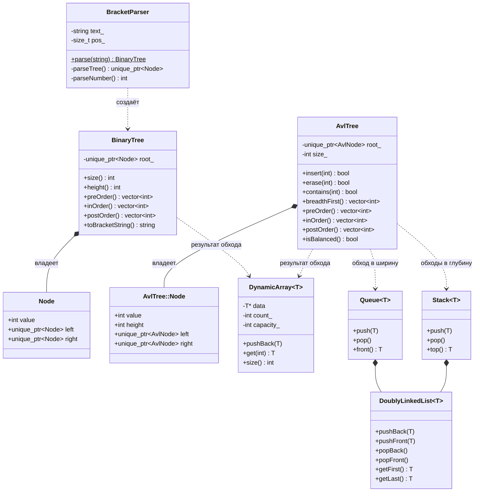

# ЛР. Деревья: двоичное дерево, скобочная запись, АВЛ-дерево

Курс «Алгоритмы и структуры данных», 3 семестр. Язык: C++17.

Программа читает дерево в скобочной записи из файла, строит обычное двоичное дерево
(или сообщает об ошибке в записи), обходит его и строит по его значениям АВЛ-дерево,
после чего выводит все узлы четырьмя способами: в ширину и тремя способами в глубину.

## Сборка и запуск

Из корня проекта (файлы читаются из папки `data/` относительно корня):

```bash
mkdir -p build && g++ -std=c++17 -Wall -Wextra -I. $(find . -name "*.cpp") -o build/trees && ./build/trees
```

Программа показывает меню: цифра 0–5 + Enter запускает сценарий, 0 — выход.

## Структура

```
.
├── main.cpp                  меню и 5 демонстрационных сценариев
├── tree/                     деревья
│   ├── BinaryTree            обычное двоичное дерево, рекурсивный обход в глубину
│   └── AvlTree               АВЛ-дерево: вставка, удаление, поиск, итеративные обходы
├── parser/
│   └── BracketParser         разбор скобочной записи -> BinaryTree
├── structures/               самописные структуры данных (шаблоны, только .h)
│   ├── DynamicArray          динамический массив
│   ├── DoublyLinkedList      двусвязный список
│   ├── Stack                 стек (на двусвязном списке)
│   └── Queue                 очередь (на двусвязном списке)
├── io/
│   └── FileReader            чтение файла в строку
└── data/                     входные файлы
    ├── ok_*.txt              правильные записи
    └── err_*.txt             записи с ошибками
```

Каждый класс — пара файлов `.h` / `.cpp`, заголовки защищены `#pragma once`.
У шаблонов в `structures/` только `.h`: шаблон должен быть виден компилятору целиком в месте использования.

## Диаграмма классов



## Скобочная запись

Грамматика:

```
дерево = "(" ")"                              пустое дерево
       | "(" число [дерево [дерево]] ")"
```

Первое вложенное дерево — левый сын, второе — правый. Пример из ТЗ:
`(8 (9 (5)) (1))` — корень 8, левый сын 9, правый 1, левый сын узла 9 — 5.

`()` — пустое поддерево. Оно нужно, чтобы записать правого сына без левого:
`(8 () (1))`. Без него `(8 (1))` читалось бы как «левый сын 1». Пробелы и переводы
строк между элементами игнорируются, числа целые, возможен минус.

Парсер — рекурсивный спуск: каждая пара скобок разбирается одним вызовом `parseTree`,
вложенные деревья — рекурсивными вызовами. Любая ошибка — исключение
`std::invalid_argument` с номером символа.

| Файл | Запись | Ошибка |
|---|---|---|
| `err_symbols.txt` | `(8 (9 (x)) (1))` | неправильный символ: ожидалось число |
| `err_brackets.txt` | `(8 (9 (5)) (1)` | не хватает закрывающей скобки |
| `err_extra_bracket.txt` | `(8 (9 (5))) (1))` | лишние символы после дерева |
| `err_not_binary.txt` | `(8 (9) (5) (1))` | у узла больше двух детей |
| `err_no_value.txt` | `(() (1))` | у узла нет значения |
| `err_empty.txt` | пустая строка | пустая запись |

Файла нет — `std::runtime_error` из `readFile`.

## Двоичное дерево `BinaryTree`

Обычное двоичное дерево: не дерево поиска (порядка значений нет) и не балансирующее
(форма такая, как в записи). Узел владеет детьми через `unique_ptr`, поэтому дерево
удаляется само, вручную `delete` нигде нет.

Обход в глубину сделан рекурсией, все три направления:

| Обход | Порядок | Для дерева `(8 (9 (5)) (1))` |
|---|---|---|
| прямой (pre-order) | корень, левое, правое | 8 9 5 1 |
| симметричный (in-order) | левое, корень, правое | 5 9 8 1 |
| обратный (post-order) | левое, правое, корень | 5 9 1 8 |

Копирование запрещено (`= delete`): `unique_ptr` не копируется, а глубокое копирование
этой лабе не нужно. Перемещение компилятор делает сам.

## АВЛ-дерево `AvlTree`

Дерево поиска (слева меньше, справа больше), в котором **у каждого узла высоты левого
и правого поддеревьев отличаются не больше чем на 1**. Поэтому высота всегда порядка
log n, а вставка, удаление и поиск работают за O(log n). В обычном дереве поиска
значения 1..7 по возрастанию дали бы цепочку высотой 7, в АВЛ — дерево высотой 3.

В узле хранится `height`. После вставки и удаления на обратном ходе рекурсии для каждого
узла вызывается `rebalance`: пересчитывает высоту и, если баланс (высота левого минус
высота правого) стал ±2, делает поворот.

| Случай | Когда | Что делаем |
|---|---|---|
| LL | слева тяжело, в левом сыне слева (или поровну) | правый поворот |
| LR | слева тяжело, в левом сыне справа | левый поворот сына, правый поворот узла |
| RR | справа тяжело, в правом сыне справа (или поровну) | левый поворот |
| RL | справа тяжело, в правом сыне слева | правый поворот сына, левый поворот узла |

Удаление, три случая для найденного узла:

| Случай | Что делаем |
|---|---|
| нет детей или один ребёнок | на место узла встаёт ребёнок (или `nullptr`) |
| два ребёнка | значение узла заменяется минимумом правого поддерева, а этот минимум удаляется |

После любого удаления идёт `rebalance` вверх по пути до корня.

Повторы не хранятся: `insert` уже существующего значения возвращает `false`. Поэтому
если в двоичном дереве значения повторялись, в АВЛ узлов будет меньше (сценарий 3
показывает, сколько повторов пропущено).

`isBalanced()` проверяет всё дерево: баланс каждого узла в пределах ±1 и записанные
`height` совпадают с настоящими. Используется в сценариях для наглядности.

| Операция | Сложность |
|---|---|
| вставка, удаление, поиск | O(log n) |
| любой обход | O(n) |

## Обходы АВЛ-дерева (итеративные)

Рекурсия запрещена, вместо неё явная структура данных (своя, из `structures/`):

| Обход | Структура | Идея |
|---|---|---|
| в ширину | `Queue` | взяли узел из начала, детей положили в конец: уровни выходят по очереди |
| прямой | `Stack` | взяли узел, записали, положили правого, потом левого (левый выйдет первым) |
| симметричный | `Stack` | уходим влево до конца, возвращаемся к последнему узлу, записываем, идём вправо |
| обратный | `Stack` + `lastVisited` | узел записываем, только когда правое поддерево уже обработано или его нет |

Память: стек хранит путь от корня (до высоты дерева), очередь — один уровень.

## Свои структуры данных

Стандартные `std::vector`, `std::stack`, `std::queue` не используются. Вместо них шаблоны
в стиле предыдущих работ (`structures/`): один класс работает для `int` и для указателей на узлы.

| Класс | Устройство | Операции |
|---|---|---|
| `DynamicArray<T>` | массив в куче; когда место кончилось, выделяется память в 2 раза больше и элементы переезжают | `pushBack` в среднем O(1), `get` O(1), `insertAt` / `removeAt` O(n) |
| `DoublyLinkedList<T>` | узлы с `prev` и `next`, указатели на первый и последний | добавление и удаление с обоих концов O(1) |
| `Stack<T>` | список, вершина = конец | `push`, `pop`, `top` за O(1) |
| `Queue<T>` | список, добавляем в конец, достаём из начала | `push`, `pop`, `front` за O(1) |

В `DynamicArray` сырой указатель, поэтому написано правило пяти: копирование, перемещение
и деструктор. Без этого результат обхода, возвращаемый из функции по значению, мог бы
удалить одну и ту же память дважды. У `DoublyLinkedList` копирование запрещено (`= delete`).
Пустой стек или очередь (`pop`, `top`, `front`) и выход за границы массива — `std::runtime_error`.

Результат любого обхода — `DynamicArray<int>`: значения в порядке обхода.

## Демонстрационные сценарии

| № | Сценарий | Что показывает |
|---|---|---|
| 1 | чтение записи из файла + двоичное дерево | пример из ТЗ, рекурсивные обходы в глубину |
| 2 | ошибки в записи | все файлы `err_*.txt` и несуществующий файл |
| 3 | двоичное дерево -> АВЛ + 4 обхода | цепочка превращается в дерево высотой 3, повторы пропускаются |
| 4 | АВЛ: вставка, поиск, удаление | повороты после каждой операции, повторная вставка, удаление листа, узла с одним и двумя детьми |
| 5 | полная цепочка для своего файла | путь вводится с клавиатуры: чтение, разбор, АВЛ, 4 обхода |

## Соответствие ТЗ

| Требование | Где |
|---|---|
| обычное двоичное дерево, рекурсивный обход в глубину | `tree/BinaryTree` |
| алгоритм парсинга скобочной записи | `parser/BracketParser` |
| АВЛ: вставка, удаление, поиск | `tree/AvlTree`: `insert`, `erase`, `contains` |
| АВЛ: обход в ширину и все 3 вида в глубину, итеративно | `tree/AvlTree`: `breadthFirst`, `preOrder`, `inOrder`, `postOrder` |
| самописные динамический массив, стек и очередь | `structures/` |
| демонстрация: чтение из файла | `io/FileReader`, сценарии 1, 5 |
| демонстрация: дерево или сообщение об ошибке | сценарии 2, 5 |
| демонстрация: обойти дерево и создать АВЛ | `buildAvl` в `main.cpp`, сценарии 3, 5 |
| демонстрация: вывод 4 способами | `printAvlTree` в `main.cpp` |

Красно-чёрное дерево (усложнённый вариант) не реализовано: сделано АВЛ-дерево.

## Ограничения

Парсер и рекурсивные обходы `BinaryTree` используют рекурсию, поэтому запись с глубиной
вложенности в десятки тысяч скобок может переполнить стек вызовов. Для учебных файлов
это не проблема.
